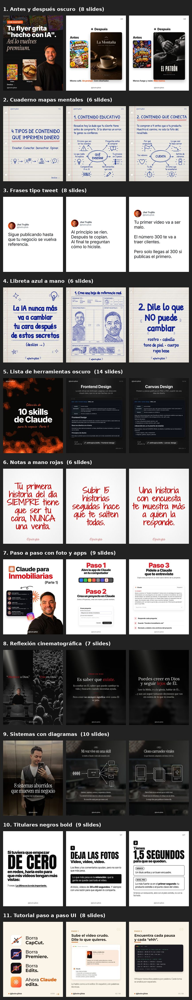

# clonar-carrusel

Skill para Claude que convierte un carrusel viral de Instagram en **tu** carrusel: la misma estructura, el mismo ritmo y la misma estética, pero con tu tema, tu voz, tus pruebas reales y tu oferta. Trae **11 estilos listos para usar** y te deja guardar los tuyos.

Creada por **Jhei Trujillo** ([@jheitrujillob](https://instagram.com/jheitrujillob)), estratega digital y creador de AIVI.

## Empieza en 3 pasos (Claude.ai, sin programar)

1. **Descarga** [`clonar-carrusel.zip`](https://github.com/contenido-wq/clonar-carrusel/raw/main/dist/clonar-carrusel.zip). No lo descomprimas.
2. En [claude.ai](https://claude.ai) ve a **Configuración → Capacidades**, activa **ejecución de código y creación de archivos** y, en **Skills**, sube el ZIP.
3. Abre un chat nuevo y escribe:

> ¿Qué estilos de carrusel tienes?

Claude te manda el catálogo, eliges uno y te pide solo tu tema, tu @ y tu llamada a la acción.

¿Claude Code, problemas o capturas de pantalla? 👉 **[Guía de instalación completa](INSTALACION.md)**

## Los 11 estilos incluidos



| Estilo | Slides | Para qué sirve |
|---|---|---|
| **Antes y después oscuro** | 8 | Fondo negro, tu foto y comparaciones antes/después con imagen. Ideal para mostrar transformaciones hechas con IA. |
| **Cuaderno mapas mentales** | 6 | Hoja de cuaderno con 4 mapas mentales y CTA en óvalo rojo. Ideal para marcos de 4 categorías. |
| **Frases tipo tweet** | 8 | Fondo blanco, tu avatar con nombre y @, una frase grande por slide. Caption corto. |
| **Libreta azul a mano** | 6 | Hoja de libreta con letra a mano azul y dibujos tipo boceto. Ideal para secretos, trucos o pasos numerados. |
| **Lista de herramientas oscuro** | 14 | Portada pixelada naranja y una herramienta por slide con su captura. Ideal para "X herramientas para tu negocio". |
| **Notas a mano rojas** | 6 | Una frase tajante por slide en letra a mano roja, palabra clave en MAYÚSCULAS. Ideal para reglas, mitos o verdades rápidas. |
| **Paso a paso con foto y apps** | 9 | Portada con tu foto y un celular con mensajes; luego Paso 1, Paso 2… con capturas. Ideal para tutoriales "Claude para tu nicho". |
| **Reflexión cinematográfica** | 7 | Foto en blanco y negro oscura, serif elegante y una palabra en cursiva roja. Ideal para reflexiones, fe o mentalidad. |
| **Sistemas con diagramas** | 10 | Tu foto de fondo oscurecida, serif blanco y un diagrama de líneas por slide. Ideal para explicar sistemas o procesos. |
| **Titulares negros bold** | 9 | Fondo blanco, titulares gigantes en negro, un consejo numerado por slide y CTA en bloque negro. Ideal para listas de consejos o errores. |
| **Tutorial paso a paso UI** | 8 | Fondo crema, mocks de interfaz, pasos 1 a 4 y prompt copiable. Ideal para mostrar un flujo con IA. |

Los ejemplos están hechos con la marca de @jheitrujillob. Cuando los usas, Claude pone **tu** @, tu nombre, tu foto y tu palabra clave.

## Cómo se usa

**Con un estilo incluido:**
> Hazme un carrusel sobre "3 errores que hacen que tus reels no vendan" con el estilo Titulares negros bold. Soy @tuusuario y la palabra es MENTORIA.

**Modelando un carrusel que viste en Instagram:**
> Quiero modelar este carrusel para mi cuenta: https://www.instagram.com/p/XXXX/

**Sin preguntas:**
> Modela este y arranca ya: (link). Soy @usuario, vendo una mentoría, la palabra es MENTORIA.

Si tu entorno no puede entrar a Instagram, la skill te pide capturas de pantalla de los slides y sigue igual.

## Agrega tus propios estilos

1. Modela un carrusel que te guste (o pásale varios links "para guardarlos").
2. Al terminar, di: **"Guárdalo como estilo"**. Queda con nombre, plantilla, muestras y ADN, y aparece en el catálogo junto a los 11 incluidos.
3. Desde ahí: *"Hazme otro sobre X con mi estilo de …"*.

**En Claude.ai** cada chat empieza desde cero, así que pide además: **"Empaqueta la skill con mis estilos"**. Claude te devuelve un `clonar-carrusel.zip` nuevo: borra la versión anterior en *Configuración → Skills* y sube ese. Tus estilos quedan disponibles en todos tus chats, y puedes pasarle ese ZIP a tu equipo.

**En Claude Code** tus estilos se guardan en la carpeta `carruseles/estilos/` y no hay que hacer nada más.

## Qué hace por dentro

1. **Te entrevista** (máximo 10 preguntas, por texto o nota de voz) y guarda tus respuestas para no repetirlas.
2. **Captura el carrusel modelo** desde el link, sin screenshots.
3. **Saca su ADN**: fórmula del gancho, rol de cada slide, paleta, tipografías y por qué funciona.
4. **Reescribe el copy** en modo *espejo* o *inspirado*. Nunca traduce frase por frase a otro creador ni inventa cifras: lo que falta queda como `[DATO A CONFIRMAR]`.
5. **Diseña y renderiza** los slides en PNG de 1080x1350, con tu @ y tu foto.
6. **Revisa la calidad** contra el original y te entrega el ZIP, el caption y 2 ganchos alternativos.

## Estructura

```
SKILL.md                  # instrucciones de la skill (flujo y modos)
estilos/                  # los 11 estilos incluidos (plantilla, muestras y ADN de cada uno)
references/
  entrevista.md           # las 10 preguntas y cómo usar las respuestas
  estilos.md              # estilos: elegir, replicar, guardar y empaquetar
scripts/
  capturar.js             # baja los slides y el caption de un post de Instagram
  render.js               # HTML → un PNG de 1080x1350 por cada <section class="slide">
  comparar.py             # hoja de comparación original contra nuevo
  estilos.py              # listar, catálogo, usar, guardar, empaquetar, rendimiento
dist/clonar-carrusel.zip  # la skill empaquetada para subir a Claude.ai
evals/                    # casos de prueba (formato de `claude plugin eval`)
```

Lo que generas queda en `carruseles/` (perfil, proyectos y estilos propios), y esa carpeta está ignorada por git.

## Pruebas

```bash
claude plugin eval . --allow-tools Write,Edit,Bash --scaffold
```

## Uso responsable

Modelar es tomar la **estructura** de lo que funciona, no copiar el contenido de otra persona. La skill escribe el copy desde cero, no redistribuye los slides originales y no dibuja logos de otras marcas.

## Licencia

[MIT](LICENSE) © 2026 Jhei Trujillo
