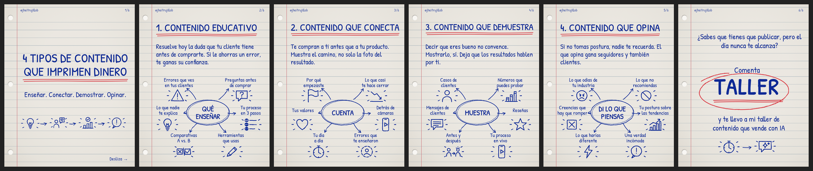
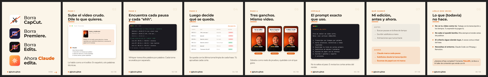
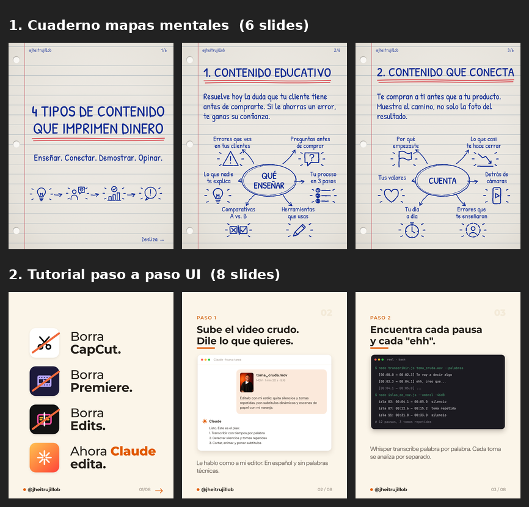

# clonar-carrusel

Skill para Claude que convierte un carrusel viral de Instagram en **tu** carrusel: la misma estructura, el mismo ritmo y la misma estética, pero con tu tema, tu voz, tus pruebas reales y tu oferta.

Creada por **Jhei Trujillo** ([@jheitrujillob](https://instagram.com/jheitrujillob)), estratega digital y creador de AIVI.




## Qué hace

1. **Te entrevista primero** (máximo 10 preguntas, por texto o nota de voz): tu Instagram, a qué te dedicas, quién es tu cliente, para qué es el carrusel (seguidores, autoridad, leads o venta) y a qué lo quieres llevar (curso, taller, mentoría o producto). Guarda tus respuestas para no preguntarte lo mismo la próxima vez.
2. **Captura el carrusel modelo** desde el link de Instagram, sin que tomes screenshots.
3. **Saca su ADN**: fórmula del gancho, rol de cada slide, paleta, tipografías y por qué funciona.
4. **Reescribe el copy** en modo *espejo* (mismo gancho, adaptado) o *inspirado* (misma estructura con tu propio ángulo). Nunca traduce frase por frase el contenido de otro creador ni inventa cifras: lo que falta queda marcado como `[DATO A CONFIRMAR]`.
5. **Diseña y renderiza** los slides en PNG de 1080x1350, con tu @ y tu foto si la das.
6. **Revisa la calidad** con una hoja de comparación (original contra el tuyo) y te entrega el caption listo y 2 ganchos alternativos.

### Biblioteca de estilos

Guarda los carruseles que te gustan como **estilos** y replícalos con otros temas sin volver a pasar un link:

- *"Guarda este como estilo"*: queda con nombre, plantilla, muestras y ADN.
- *"¿Qué estilos tengo?"*: te manda un catálogo visual.
- *"Hazme uno sobre X con el de cuaderno"*: reutiliza la plantilla y solo reescribe el contenido.
- Opcional: si pasas métricas (alcance, guardados, comentarios), te arma un ranking según tu objetivo.



## Instalación

**Claude Code:** clona el repo dentro de tus skills.

```bash
git clone https://github.com/contenido-wq/clonar-carrusel ~/.claude/skills/clonar-carrusel
```

**Claude.ai:** descarga el repo como ZIP y súbelo en *Settings → Capabilities → Skills*.

### Requisitos

- Node.js con [Playwright](https://playwright.dev) y Chromium (`npm i playwright && npx playwright install chromium`).
- Python 3 con Pillow (`pip install pillow`).
- Acceso de red a `instagram.com`, `cdninstagram.com` y Google Fonts. Si tu entorno usa proxy, los scripts toman `HTTPS_PROXY` automáticamente.

## Uso

Pásale a Claude el link y lo que quieres:

> Quiero modelar este carrusel para mi cuenta: https://www.instagram.com/p/XXXX/

> Hazme uno sobre "3 errores que hacen que tus reels no vendan" con mi estilo de cuaderno.

> Modela este y arranca ya, sin preguntas: (link). Soy @usuario, vendo una mentoría, la palabra es MENTORIA.

## Estructura

```
SKILL.md                  # instrucciones de la skill (flujo y modos)
references/
  entrevista.md           # las 10 preguntas y cómo usar las respuestas
  estilos.md              # biblioteca de estilos: guardar, elegir, replicar
scripts/
  capturar.js             # baja los slides y el caption de un post de Instagram
  render.js               # HTML → un PNG de 1080x1350 por cada <section class="slide">
  comparar.py             # hoja de comparación original contra nuevo
  estilos.py              # guardar, listar, catálogo, rendimiento y ranking de estilos
evals/                    # casos de prueba (formato de `claude plugin eval`)
```

Lo que generas queda en `carruseles/` (perfil, proyectos y biblioteca de estilos), y esa carpeta está ignorada por git.

## Pruebas

Los casos de `evals/` cubren 4 situaciones: un cliente nuevo que responde por nota de voz, un cliente con perfil guardado, alguien que dice "arranca sin preguntas" y la replicación de un estilo guardado. Con Claude Code:

```bash
claude plugin eval . --allow-tools Write,Edit,Bash --scaffold
```

## Uso responsable

Modelar es tomar la **estructura** de lo que funciona, no copiar el contenido de otra persona. La skill escribe el copy desde cero, no redistribuye los slides originales y no dibuja logos de otras marcas. Usa las capturas solo como referencia de trabajo.

## Licencia

[MIT](LICENSE) © 2026 Jhei Trujillo
